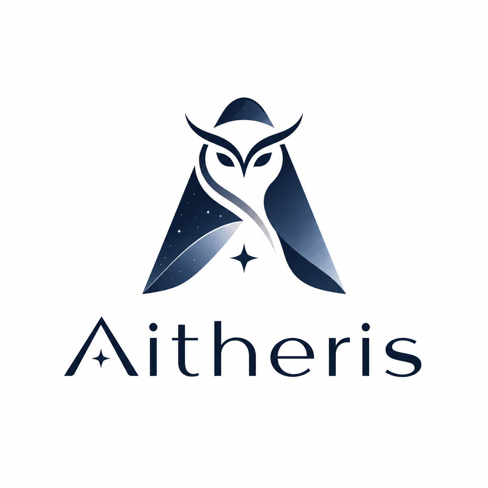
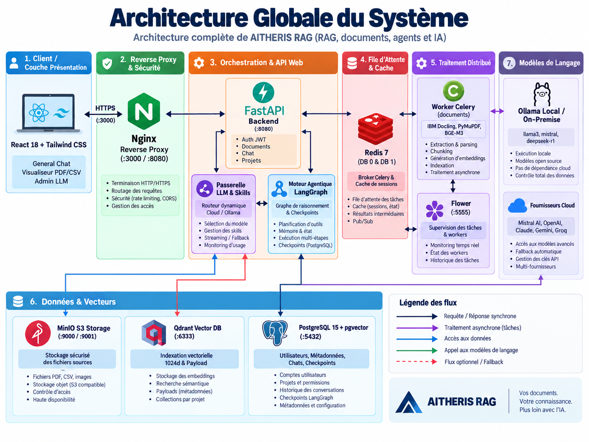
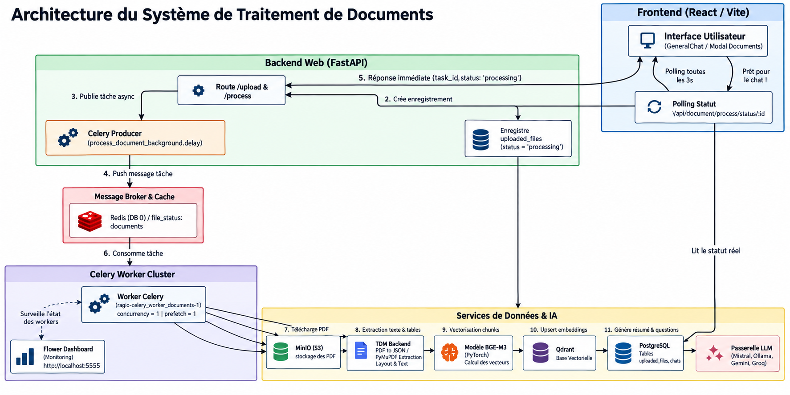
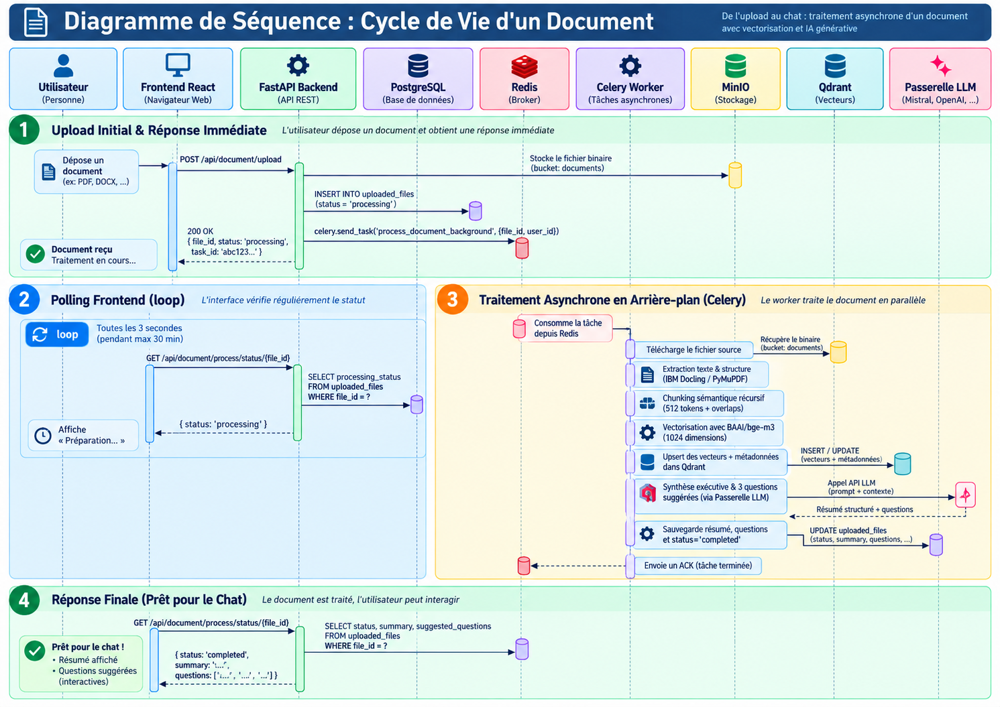
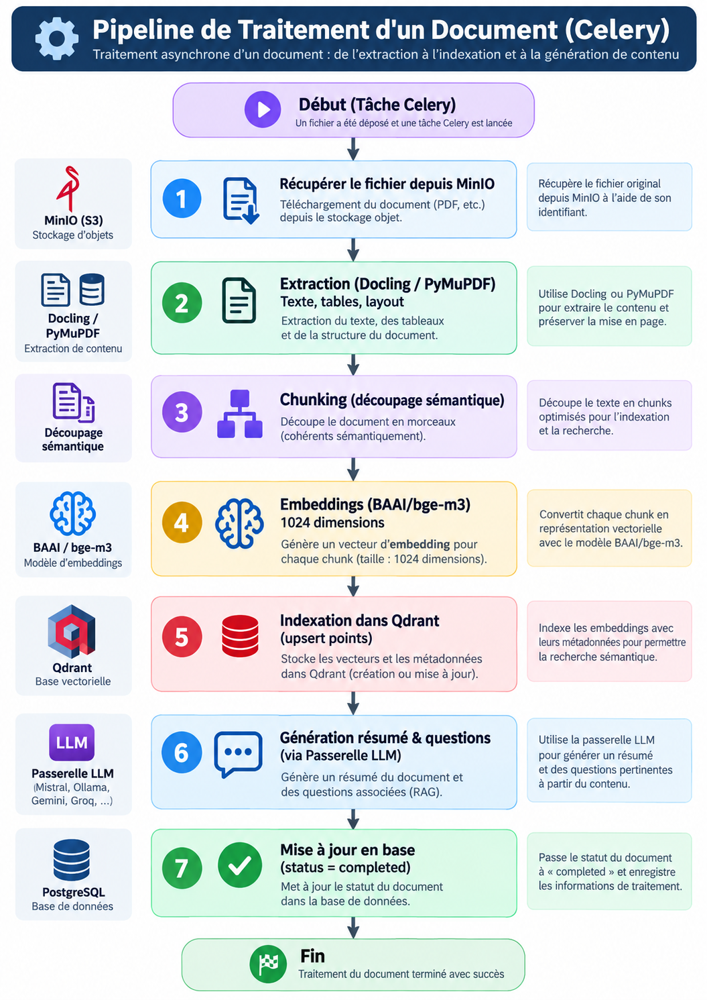
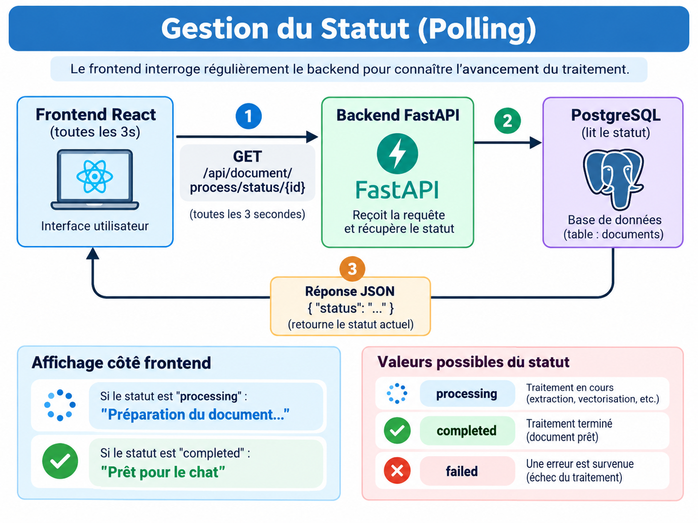
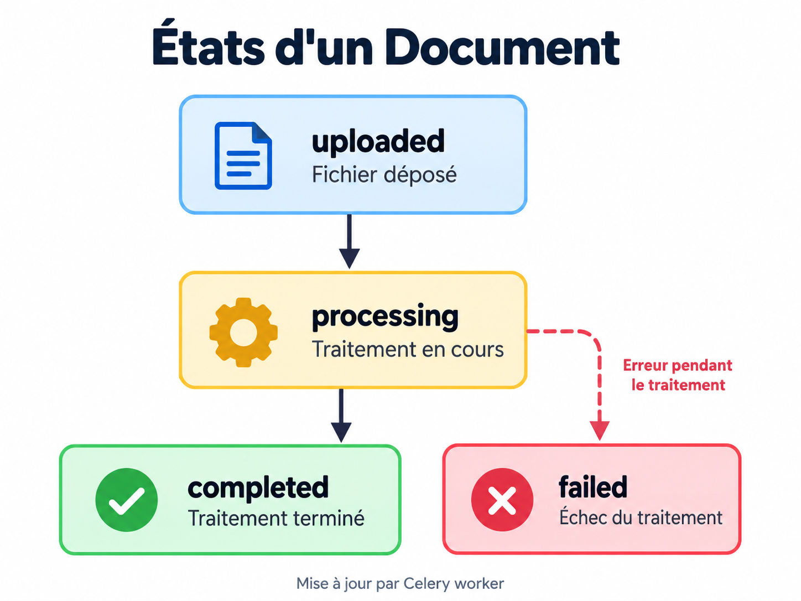
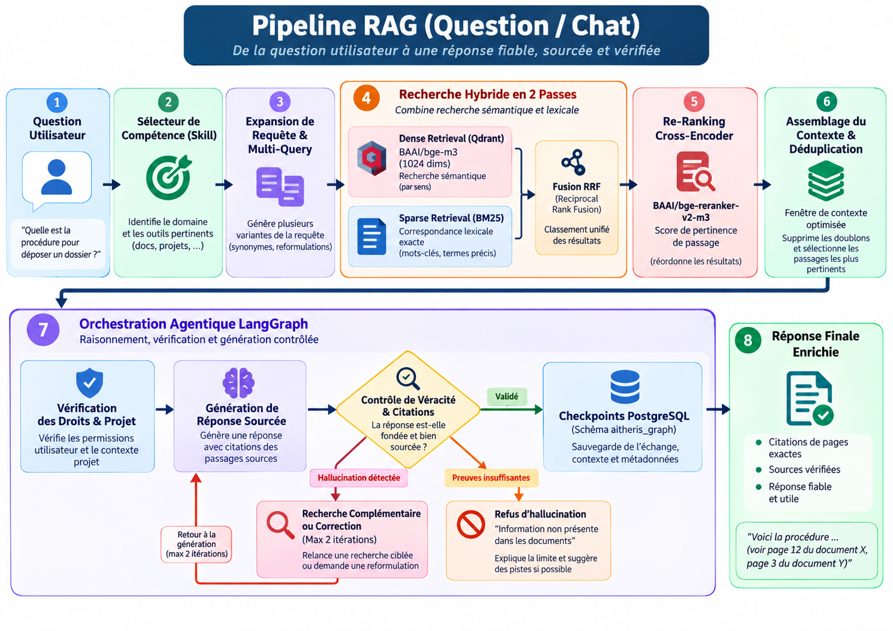

# AITHERIS RAG

<div align="center">



### Système d'Intelligence Documentaire & Moteur RAG Agentique d'Entreprise

Une plateforme complète et modulaire de Retrieval-Augmented Generation (RAG) combinant ingestion asynchrone distribuée, recherche hybride (dense + sparse), reclassement cross-encoder, passerelle multi-LLM (Cloud & Ollama local) et orchestration agentique via LangGraph.

[](https://www.python.org/)
[](https://fastapi.tiangolo.com/)
[](https://react.dev/)
[](https://docs.celeryq.dev/)
[](https://redis.io/)
[](https://qdrant.tech/)
[](https://www.postgresql.org/)
[](https://docs.docker.com/compose/)

[Architecture](#architecture-du-système) · [Cycle de Vie & Ingestion](#cycle-de-vie-dun-document--traitement-asynchrone) · [Pipeline RAG Hybride](#pipeline-rag-hybride--agentique) · [Passerelle Multi-LLM](#passerelle-multi-llm--moteur-de-skills) · [Démarrage Rapide](#guide-de-démarrage-rapide) · [API REST](#points-daccès-api-principaux) · [Auteur](#-concepteur--architecte)

</div>

---

## 🌟 Présentation Générale

**AITHERIS RAG** est une solution logicielle d'intelligence documentaire conçue pour les environnements professionnels exigeants. Elle permet de transformer de vastes corpus documentaires hétérogènes (PDF volumineux, rapports, contrats, fichiers CSV, Markdown, textes) en bases de connaissances vectorielles immédiatement exploitables par des modèles de langage avancés.

### Piliers Fondamentaux de la Plateforme :
- **Ingestion Asynchrone & Haute Résilience** : Découplage complet entre l'API web et les tâches de traitement lourd via **Celery**, **Redis** et **IBM Docling** / **PyMuPDF**, garantissant une fluidité totale même lors de l'import de documents de plus de 200 pages.
- **Précision Vectorielle de Pointe** : Utilisation du modèle multilingue **BAAI/bge-m3** (1024 dimensions) couplé à une recherche lexicale **BM25** (recherche hybride) et un reclassement systématique par **BAAI/bge-reranker-v2-m3**.
- **Passerelle Multi-LLM (Cloud & On-Premise)** : Intégration transparente de modèles hébergés localement via **Ollama** (Llama 3, Mistral, DeepSeek) et de fournisseurs Cloud majeurs (Mistral AI, OpenAI, Anthropic Claude, Google Gemini, Groq) avec gestion dynamique des clés depuis l'interface d'administration.
- **RAG Agentique & Contrôlé (LangGraph)** : Workflow d'analyse multi-étapes assurant la vérification sémantique des citations, la détection des hallucinations, la gestion de checkpoints PostgreSQL pour reprise sur incident et la validation humaine optionnelle (Human-in-the-loop).
- **Moteur de Compétences Spécialisées (Skills)** : Système dynamique de prompts experts (`.md`) sélectionnables en temps réel dans le chat général (analyse juridique, synthèse technique, audit de sécurité, etc.).
- **Sécurité & Gouvernance d'Entreprise** : Authentification JWT (access + refresh tokens), gestion collaborative de projets multi-utilisateurs avec contrôle d'accès RBAC (Propriétaire, Administrateur, Contributeur, Lecteur) et quotas par utilisateur.

---

## 🏗️ Architecture du Système

L'architecture d'AITHERIS RAG repose sur une suite de microservices conteneurisés garantissant scalabilité horizontale, isolation des ressources et haute disponibilité.

### Schéma d'Architecture Globale du Système



### Architecture du Système de Traitement Asynchrone (Celery & Services)



### Rôles des Microservices

| Service | Technologie | Port d'écoute | Rôle & Responsabilités |
| :--- | :--- | :--- | :--- |
| **frontend** | React 18, Vite/Nginx | `3000` | Interface utilisateur réactive, visualisation documentaire, gestion de chat et panel admin |
| **backend** | FastAPI, Python 3.12 | `8080` | API REST, orchestration RAG, validation des règles métiers, passerelle LLM & Guardrails |
| **celery_worker** | Celery, PyTorch | Interne | Extraction documentaire lourde, découpage sémantique, vectorisation et résumés |
| **redis** | Redis 7 Alpine | `6379` | Broker de messages pour Celery et cache applicatif haute vitesse |
| **postgres** | PostgreSQL 15 | `5432` | Stockage relationnel des comptes, documents, conversations, projets, checkpoints & Langfuse |
| **minio** | MinIO Object Store | `9000` / `9001` | Stockage objet compatible S3 pour l'archivage sécurisé des fichiers originaux |
| **qdrant** | Qdrant Engine | `6333` / `6334` | Moteur de base de données vectorielle pour les embeddings BGE-M3 |
| **flower** | Flower Dashboard | `5555` | Monitoring en temps réel de la santé et de la performance des workers Celery |
| **prometheus** | Prometheus v2.50 | `9090` | Collecte des métriques applicatives, temps de réponse, tokens et alertes de sécurité |
| **grafana** | Grafana 10.3 | `3001` | Tableaux de bord visuels interactifs préconfigurés pour la supervision globale |
| **langfuse** | Langfuse v2 | `3002` | Traçage distribué des prompts LLM, RAG retrieval, guardrails et analyse des coûts |

---

## 🔄 Cycle de Vie d'un Document & Traitement Asynchrone

L'ingestion documentaire suit un protocole asynchrone non-bloquant en quatre phases majeures. Cela garantit que le serveur web ne subit aucun ralentissement pendant que des calculs intensifs (OCR, vectorisation par lots) sont exécutés sur les workers.

### Diagramme de Séquence : Cycle de Vie d'un Document



### Pipeline de Traitement d'un Document par les Workers Celery

De l'extraction à l'indexation vectorielle et à la génération du résumé analytique :



### Gestion du Statut en Temps Réel (Polling Frontend)

Le client web interroge le backend toutes les 3 secondes pour afficher la progression sans rechargement de page :



### Machine à États d'un Document



---

## 🧠 Pipeline RAG Hybride & Agentique

AITHERIS RAG intègre une chaîne de récupération en deux passes suivie d'une vérification agentique pilotée par **LangGraph** pour garantir des réponses exactes, sourcées et sans hallucination.

### Pipeline RAG Complet (Question / Chat)



### Les 8 Étapes du Traitement d'une Requête :

1. **Question Utilisateur** : Saisie de la question avec sélection éventuelle de documents ciblés.
2. **Sélecteur de Compétence (Skill)** : Activation d'une casquette méthodologique spécialisée (analyse juridique, synthèse exécutive, etc.).
3. **Expansion de Requête & Multi-Query** : Reformulation sémantique et génération de variantes par LLM pour maximiser le rappel documentaire.
4. **Recherche Hybride en 2 Passes** :
   - *Dense Retrieval (Qdrant)* : Recherche sémantique par sens vectoriel via `BAAI/bge-m3` (1024 dimensions).
   - *Sparse Retrieval (BM25)* : Correspondance lexicale exacte sur les termes précis, sigles et références numériques.
   - *Fusion RRF (Reciprocal Rank Fusion)* : Consolidation unifiée des résultats classés.
5. **Re-Ranking Cross-Encoder** : Évaluation précise de la pertinence de chaque paire (question, passage) avec `BAAI/bge-reranker-v2-m3`.
6. **Assemblage du Contexte & Déduplication** : Sélection des passages les plus pertinents et suppression des redondances pour optimiser la fenêtre de contexte.
7. **Orchestration Agentique LangGraph** :
   - Vérification des droits et du projet.
   - Génération de réponse sourcée avec attribution stricte.
   - Contrôle de véracité et validation des citations (recherche complémentaire ou correction jusqu'à 2 itérations).
   - Refus explicite d'halluciner si l'information est absente des documents sources.
   - Sauvegarde de l'état dans les checkpoints PostgreSQL (schéma `aitheris_graph`).
8. **Réponse Finale Enrichie** : Restitution à l'utilisateur avec citations interactives de pages et extraits vérifiables.

---

## 🔌 Passerelle Multi-LLM & Moteur de Skills

### 1. Passerelle Dynamique LLM (Cloud & Ollama)
Le module `app.services.llm_gateway` abstrait les interactions avec les fournisseurs de modèles. La configuration s'effectue dynamiquement depuis l'interface d'administration `/admin/llm` sans redémarrer les conteneurs.

- **Ollama (Local / Souverain)** : Exécution de modèles open-source en local (`llama3:latest`, `mistral:latest`, `deepseek-r1:latest`).
- **Fournisseurs Cloud** : Support natif de Mistral AI, OpenAI (GPT-4o, GPT-3.5), Anthropic Claude, Google Gemini et Groq.
- **Failover Automatique** : Basculement automatique en cas d'indisponibilité ou d'erreur de quota d'un fournisseur tiers.

### 2. Moteur de Compétences (Skills Engine)
Les compétences sont des modules d'expertise stockés sous format Markdown dans `backend/app/skills/` (ex: `expert-juridique.md`, `synthese-executive.md`, `audit-conformite.md`).

- **Sélection à la volée** : L'utilisateur active la compétence souhaitée via le composant `SkillSelector` dans le chat.
- **Injection contextuelle** : Le prompt système est automatiquement enrichi avec les consignes méthodologiques du skill sélectionné.

---

## 🛡️ Sécurité & Guardrails (NeMo + Presidio)

AITHERIS RAG intègre une double ligne de défense pour garantir la confidentialité et la robustesse du système face aux attaques :

### 1. Microsoft Presidio (Anonymisation PII / DLP)
- **Détection automatique** des données sensibles dans les requêtes utilisateur (adresses email, numéros de téléphone, numéros de carte bancaire, codes IBAN, numéros de sécurité sociale français NIR, adresses IP).
- **Anonymisation réversible** : Les données sensibles sont remplacées par des jetons typés (ex: `<EMAIL_ADDRESS_1>`) avant toute transmission aux modèles de langage tiers (garantie de conformité RGPD).
- **Dé-anonymisation sécurisée** : Les valeurs originales sont restituées en sortie pour l'utilisateur final autorisé.

### 2. NVIDIA NeMo Guardrails (Input & Output Rails)
- **Input Rails (Protection contre les injections & Jailbreaks)** :
  - Blocage immédiat des attaques de type *Prompt Injection* (ex: "Ignore previous instructions", DAN, tentative d'exfiltration des clés API ou du prompt système).
  - Contrôle thématique et filtrage des demandes hors périmètre documentaire légitime.
- **Output Rails (Fact-Checking & Anti-Hallucination)** :
  - Vérification de fidélité documentaire pour empêcher les réponses non fondées.

---

## 📊 Observabilité Complète (Prometheus, Grafana & Langfuse)

La plateforme intègre une suite d'observabilité de niveau entreprise :

1. **Prometheus (`:9090`)** : Scrape en continu les métriques de FastAPI (`/metrics`), des workers Celery et des Guardrails.
2. **Grafana (`:3001`)** : Dashboards préconfigurés prêts à l'emploi (mot de passe par défaut : `admin` / `aitheris`) :
   - *Taux de requêtes & latences p95 par étape RAG*.
   - *Violations de sécurité interceptées & entités PII masquées*.
   - *Volume de tokens LLM consommés (Input / Output)*.
   - *État et débit des tâches d'ingestion Celery*.
3. **Langfuse (`:3002`)** : Plateforme dédiée au traçage distribué des LLM. Visualisation de chaque prompt, des passages de contexte extraits, des scores de re-ranking, des évaluations de fidélité et des coûts en temps réel.

---

## 👥 Projets & Collaboration Multi-Utilisateurs


La plateforme intègre un espace de travail collaboratif (`/rag-workflows` et `/projects`) avec gestion fine des permissions (RBAC) :

| Rôle | Consulter Documents & Analyses | Lancer & Reprendre une Analyse | Approuver / Rejeter (Validation) | Gérer les Membres du Projet |
| :--- | :---: | :---: | :---: | :---: |
| **Propriétaire (Owner)** | ✅ | ✅ | ✅ | ✅ |
| **Administrateur** | ✅ | ✅ | ✅ | ❌ |
| **Contributeur** | ✅ | ✅ | ❌ | ❌ |
| **Lecteur (Viewer)** | ✅ | ❌ | ❌ | ❌ |

---

## 📂 Structure du Répertoire

```text
AITHERIS RAG/
├── assets/                          # Schémas d'architecture et visuels officiels
│   ├── aitheris-logo.png           # Logo de la plateforme
│   ├── toph.png                    # Photo du concepteur (Oualid Ghaffari)
│   ├── GlobaleArchitecture.png     # Architecture globale du système
│   ├── Celery.png                  # Architecture du système de traitement Celery
│   ├── D.png                       # Diagramme de séquence du cycle documentaire
│   ├── PiplineTratementDocs.png    # Pipeline de traitement asynchrone par étapes
│   ├── Polling.png                 # Mécanisme de polling du statut
│   ├── EtatDocs.png                # Machine à états des documents
│   └── PiplineRag.png              # Pipeline complet de requête RAG & LangGraph
├── backend/                         # Moteur API et traitement asynchrone
│   ├── app/
│   │   ├── db/                     # Modèles SQLAlchemy et session PostgreSQL
│   │   ├── routes/                 # Endpoints REST (auth, document, chat, llm, skills)
│   │   ├── services/               # Logique métier (RAG, Gateway, LangGraph, Quotas)
│   │   ├── skills/                 # Définition des compétences (.md)
│   │   └── tasks/                  # Tâches Celery d'ingestion documentaire
│   ├── migrations/                 # Migrations Alembic pour PostgreSQL
│   ├── scripts/                    # Téléchargement et mise en cache des modèles HF
│   ├── tests/                      # Tests unitaires et d'intégration
│   ├── celery_app.py               # Configuration de l'application Celery
│   ├── Dockerfile.local            # Conteneurisation du backend pour dev
│   └── requirements.txt            # Dépendances Python
├── frontend/                        # Interface utilisateur React 18
│   ├── public/                     # Assets statiques et manifest
│   ├── src/
│   │   ├── components/             # Composants UI (Chat, DocumentViewer, Admin LLM)
│   │   └── services/               # Appels API Axios et gestion d'état Zustand
│   ├── nginx.conf                  # Configuration du serveur web Nginx
│   ├── package.json                # Dépendances Node.js
│   └── tailwind.config.js          # Configuration graphique Tailwind CSS
├── docker-compose.local.yml         # Définition complète de la pile de conteneurs
├── .env.local.example               # Modèle de variables d'environnement
├── CELERY_ARCHITECTURE.md          # Guide technique dédié à Celery
├── README.md                        # Documentation de référence principale
├── ragio                            # Script de gestion CLI pour Linux / macOS
└── ragio.ps1                        # Script de gestion CLI pour Windows PowerShell
```

---

## 🚀 Guide de Démarrage Rapide

### Prérequis
- **Docker Engine** (v24+) & **Docker Compose v2**
- **RAM recommandée** : 16 Go (minimum 8 Go pour exécuter les conteneurs et le cache des modèles)
- **Espace disque** : ~12 Go disponibles pour les images Docker et le cache HuggingFace

### 1. Cloner le Répertoire & Configurer l'Environnement
```bash
cp .env.local.example .env.local
```
Éditer `.env.local` pour définir vos clés API (Mistral, OpenAI, etc.) ou configurer votre endpoint local Ollama (`http://host.docker.internal:11434`).

### 2. Démarrage de la Pile Docker

#### Via le script PowerShell (Windows) :
```powershell
.\ragio.ps1 up
```

#### Via le script Bash (Linux / macOS) :
```bash
chmod +x ./ragio
./ragio up
```

#### Via Docker Compose standard :
```bash
docker compose -p ragio --env-file .env.local -f docker-compose.local.yml up -d --build
```

> **Note d'initialisation** : Au premier lancement, le conteneur `model_init` télécharge automatiquement les modèles `BAAI/bge-m3` et `BAAI/bge-reranker-v2-m3` dans un volume partagé sécurisé. Les conteneurs `backend` et `celery_worker` attendent la fin de cette étape pour démarrer.

### 3. Accès aux Services

- **Application Web Aitheris** : [http://localhost:3000](http://localhost:3000)
- **Documentation API (Swagger)** : [http://localhost:8080/docs](http://localhost:8080/docs)
- **Tableau de bord Celery (Flower)** : [http://localhost:5555](http://localhost:5555)
- **Tableau de bord Grafana** : [http://localhost:3001](http://localhost:3001) *(Identifiants : admin / aitheris)*
- **Serveur d'Observabilité Langfuse** : [http://localhost:3002](http://localhost:3002)
- **Métriques Prometheus** : [http://localhost:9090](http://localhost:9090)
- **Console Object Storage MinIO** : [http://localhost:9001](http://localhost:9001) *(Identifiants : minioadmin / minioadmin)*
- **Console Vectorielle Qdrant** : [http://localhost:6333/dashboard](http://localhost:6333/dashboard)

---

## 📡 Points d'Accès API Principaux

| Méthode | Endpoint | Description |
| :--- | :--- | :--- |
| `POST` | `/api/auth/register` | Inscription d'un nouvel utilisateur |
| `POST` | `/api/auth/login` | Authentification et obtention des jetons JWT |
| `POST` | `/api/document/upload` | Téléversement d'un document et soumission à Celery |
| `GET` | `/api/document/process/status/{id}` | Suivi de la progression du traitement asynchrone |
| `POST` | `/api/chat/ask` | Requête de chat RAG avec sélection de sources |
| `GET` | `/api/guardrails/status` | Statut de santé des moteurs NeMo et Presidio |
| `POST` | `/api/guardrails/test` | Test d'anonymisation PII et détection d'injection |
| `GET` | `/api/skills` | Liste des compétences métier disponibles |
| `POST` | `/api/admin/llm/config` | Configuration dynamique des modèles et clés API |
| `POST` | `/api/rag-workflows/runs` | Lancement d'un workflow d'analyse agentique LangGraph |
| `GET` | `/api/projects` | Gestion des espaces et projets collaboratifs |

---

## 🛡️ Maintenance & Tests

### Exécution des Tests Backend
```bash
# Vérification des modèles BGE
python -m unittest discover -s backend/tests -p test_bge_configuration.py

# Tests du graphe agentique LangGraph
python -m unittest discover -s backend/tests -p test_rag_graph.py
```

### Surveillance des Logs en Direct
```powershell
# Logs du worker Celery
docker compose -p ragio -f docker-compose.local.yml logs -f celery_worker_documents

# Logs de l'API FastAPI
docker compose -p ragio -f docker-compose.local.yml logs -f backend
```

---

## 👨‍💻 Concepteur & Architecte

<div align="center">


### **Oualid Ghaffari**
*Lead Architect & AI Engineer*

Conception, architecture technique et développement complet de la plateforme **AITHERIS RAG**.

</div>

---

## 📄 Licence
Ce projet est distribué sous licence MIT. Consultez le fichier `LICENSE` pour plus de détails.

# AitherisRAG

